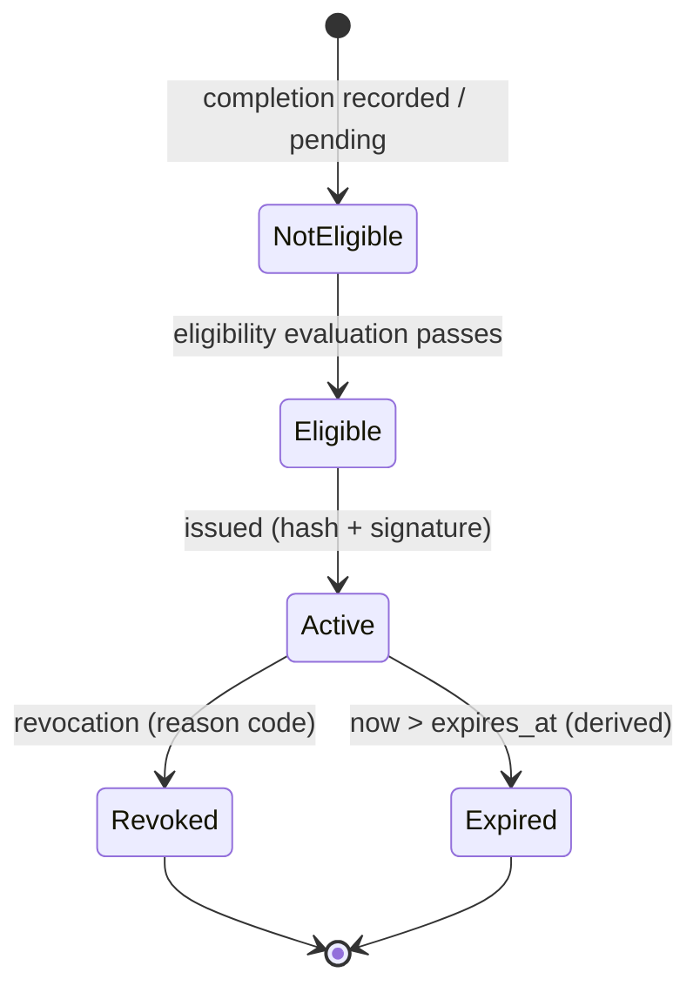

# CredSure: Product Requirements Document

| Item | Value |
|------|-------|
| Product | CredSure: Digital Credential Lifecycle Management Platform |
| Version | 1.0 (hackathon MVP specification) |
| Time box | 7 hours total. Environment setup (Task 01) and this specification (Task 00) are complete. |
| Stack | React + TypeScript + Tailwind · FastAPI · SQLAlchemy · SQLite · Alembic · pytest / Vitest |
| Related docs | [business_rules](business_rules.md) · [user_stories](user_stories.md) · [architecture](architecture.md) · [data_dictionary](data_dictionary.md) · [exception_catalogue](exception_catalogue.md) · [api_contract](api_contract.md) · [roadmap](roadmap.md) · [architecture_decisions](architecture_decisions.md) |

---

## 1. Problem statement

Educational institutions must issue credentials **only after** learners meet defined course
completion requirements. Once issued, a credential must be:

- independently verifiable by third parties
- protected against tampering
- revocable
- traceable through an audit history that cannot be overwritten

Institutions also need to detect process failures, such as credentials issued too early,
duplicate identifiers, or verifiers wrongly accepting revoked or altered credentials. They need
to measure detection quality against known ground truth.

## 2. Goals and non-goals

### Goals (MVP)

1. Record learners, courses, issuers, versioned credential rules and completion records.
2. Evaluate eligibility deterministically against the applicable rule version.
3. Issue credentials only when eligible. Each credential has a canonical payload, a SHA-256 hash and an Ed25519 signature.
4. Verify credentials publicly. Detect tampering, invalid signatures, revocation and expiry.
5. Revoke credentials with a reason code. Revoked credentials never verify as valid.
6. Write an append-only, hash-chained audit event for every important decision.
7. Generate reproducible synthetic data (seed `20261022`) at starter and full scale, with injected anomalies and separate ground truth.
8. Detect the four required anomalies, compute metrics from source records, and score detection against ground truth.
9. Show all of the above in a working end-to-end demo through the React UI.

### Non-goals (explicitly out of scope)

- Real authentication or SSO. Roles are simulated with request headers ([ADR-010](architecture_decisions.md#adr-010-simulated-role-based-access-via-request-headers)).
- Email or notifications, PDF or QR credential rendering, wallets.
- Compliance with W3C Verifiable Credentials or Open Badges. The payload is inspired by them but not compliant.
- Key rotation UI, HSM or KMS, revocation lists published to third parties.
- Multi-tenant institutions, internationalisation, deployment, Docker, PostgreSQL, microservices.
- Machine-learning anomaly detection. Detection is rule-based and deterministic.

## 3. Actors and permissions

Six actors interact with CredSure. Without real authentication, each request carries
`X-Actor-Id` and `X-Actor-Role`. See [api_contract](api_contract.md#2-actor-headers-and-authorisation).

| Actor | Role code | Responsibilities |
|-------|-----------|------------------|
| Learner | `learner` | Views own completion records and credentials. Retrieves the signed credential to share with verifiers. |
| Instructor | `instructor` | Records completion, score and attendance for learners on courses they teach. Views course rules. |
| Academic Administrator | `academic_admin` | Owns academic master data: learners, courses, credential rules. Issues and revokes credentials. |
| Support Staff | `support_staff` | Read-only help desk. Looks up learners, credentials, verification history and audit trails. Can run verifications on behalf of callers. Cannot change records. |
| Platform Administrator | `platform_admin` | Manages issuers and signing keys. Imports synthetic data, runs anomaly detection, checks audit-chain integrity, views metrics. Does not issue or revoke credentials (separation of duties). |
| External Verifier | `external_verifier` | Unauthenticated third party, such as an employer. Submits a credential (ID and optional payload and signature) and receives a verification result. |

### Permission matrix

Legend: **C** create · **R** read · **U** update · **X** execute · **own** limited to own records · **course** limited to courses where the actor is lead instructor (if set) · – no access

| Capability | Learner | Instructor | Acad. Admin | Support | Platform Admin | Ext. Verifier |
|------------|:-------:|:----------:|:-----------:|:-------:|:--------------:|:-------------:|
| Issuers | – | – | R | R | C R U(status) | R (public key only) |
| Learners | R own | R | C R U | R | R | – |
| Courses | – | R | C R U | R | R | – |
| Credential rules | – | R | C R X(activate) | R | R | – |
| Completion records | R own | C R U course | C R U | R | R | – |
| Eligibility evaluation | X own | X course | X | X | X | – |
| Issue credential | – | – | X | – | – | – |
| Revoke credential | – | – | X | – | – | – |
| Credentials | R own | R course | R | R | R | – |
| Verify credential | X | X | X | X | X | X (public) |
| Verification history | R own credentials | – | R | R | R | – |
| Audit log | – | – | R | R | R + X(chain check) | – |
| Metrics dashboard | – | – | R | R | R | – |
| Anomaly detection | – | – | R | – | X R | – |
| Synthetic data import | – | – | – | – | CLI only | – |

## 4. Credential lifecycle

`NotEligible` and `Eligible` are computed states; they are not stored. `Expired` is derived at
verification time from `expires_at`. Only `active` and `revoked` are stored in
`credentials.status`.

### End-to-end workflow

| # | Step | Actor | Output | Audit event |
|---|------|-------|--------|-------------|
| 1 | Master data: issuer, learner, course, credential rule (draft, then activate) | Platform admin, Academic admin | Rows in `issuers`, `learners`, `courses`, `credential_rules` | `issuer.created`, `learner.created`, `course.created`, `rule.created`, `rule.activated` |
| 2 | Record completion and assessment (status, score, attendance, completed_at) | Instructor | `completion_records` row | `completion.recorded` / `completion.corrected` |
| 3 | Evaluate eligibility against the rule version in effect at `completed_at` | Academic admin (or any reader) | `{eligible, reasons[], rule_id, completion_id}` | `eligibility.evaluated` (on issuance) |
| 4 | Issue credential: ID generated, payload built from source records | Academic admin | `credentials` row (`active`) | `credential.issued` or `credential.issue_rejected` |
| 5 | SHA-256 hash of the canonical JSON payload | System | `payload_hash` (64 hex) | included in `credential.issued` details |
| 6 | Ed25519 signature over the canonical payload bytes with the issuer key | System | `signature` (base64), `signing_key_id` | included in `credential.issued` details |
| 7 | Third-party verification | External verifier | `verification_requests` row with result | `verification.performed` |
| 8 | Revocation with reason code | Academic admin | `revocations` row; credential `status=revoked` | `credential.revoked` / `credential.revoke_rejected` |
| 9 | Immutable audit history | System | Append-only, hash-chained `audit_events` | (every step) |
| 10 | Metrics and anomaly evaluation | Platform admin | Metrics JSON; anomaly findings; precision/recall vs ground truth | `anomaly.run_completed` |

Sequence diagrams for issuance, verification and revocation are in
[architecture.md §5](architecture.md#5-key-workflows).

## 5. Functional requirements

Priority: **M** must (needed for the demo) · **S** should · **C** could (only if time allows).

### Master data

| ID | Requirement | Pri |
|----|-------------|-----|
| FR-01 | Create, list, view and update learners. `learner_id` is system-assigned (`LRN-0000001`), unique and immutable. Names are not identifiers. | M |
| FR-02 | Create, list, view and update courses. `course_code` is unique. Each course references exactly one issuer. | M |
| FR-03 | Create issuers with an Ed25519 key pair. Store the public key; keep the private key in a git-ignored key file. Issuer rows are never deleted. Changes create a new row that supersedes the old one. | M |
| FR-04 | Create credential rules as `draft`, then activate them. Activation sets `effective_from` (optional, defaults to now, may be backdated but never into the future) and retires the previous active version (`effective_to = effective_from`). Activation is rejected if it would change the applicable rule of an already recorded completion (D5). Active and retired rules are immutable. | M |
| FR-05 | List and search with `limit`/`offset` and simple filters. | S |

### Completion and eligibility

| ID | Requirement | Pri |
|----|-------------|-----|
| FR-06 | Record completion records: status, score 0–100, attendance 0–100, `completed_at`, `attempt_number`. `completed_at` must not be in the future. | M |
| FR-07 | Correct a completion record only while no active credential references it. Each correction is audited with before and after values. | S |
| FR-08 | Eligibility endpoint returns `eligible`, the applied `rule_id` and version, the `completion_id` used, and a list of failing reasons. The checks are in [BR-04](business_rules.md#br-04). | M |

### Issuance and integrity

| ID | Requirement | Pri |
|----|-------------|-----|
| FR-09 | Issue a credential only if eligibility passes inside the same database transaction. | M |
| FR-10 | Generate unique credential IDs (`CRED-` + 12 Crockford base32 characters). A duplicate ID (case-insensitive) is checked **before** eligibility, rejected with `duplicate_credential_id`, and audited. Every issuance attempt has a unique `attempt_ref` and ends with exactly one terminal audit event, even when the insert fails. The database enforces at most one; the service's transaction logic guarantees one (D7). | M |
| FR-11 | Build the canonical payload from source records. Compute SHA-256 over its UTF-8 bytes. Sign the same bytes with Ed25519. Store `payload_json`, `payload_hash`, `signature` and `signing_key_id`. Scores are fixed-point strings (`"82.50"`); no floats in signed payloads (D6). Timestamps are whole-second UTC (D2). | M |
| FR-12 | Shareable endpoint returns payload, signature, hash, issuer ID and key ID for a credential. | M |
| FR-13 | Public endpoint returns an issuer's public key for offline verification. | S |

### Verification and revocation

| ID | Requirement | Pri |
|----|-------------|-----|
| FR-14 | Public verification accepts a credential ID and optionally a presented payload and signature. It returns one of `valid`, `revoked`, `expired`, `tampered`, `invalid_signature` or `not_found`, plus individual check flags. | M |
| FR-15 | Every verification attempt, including `not_found`, is stored in `verification_requests` and audited. | M |
| FR-16 | Revoke an active credential with a mandatory reason code (and reason text when the code is `other`). In one transaction, insert a `revocations` row and perform the only permitted transition, `active → revoked`. Revocation is irreversible: a revoked credential cannot be reinstated, and the database enforces this (D1). | M |

### Audit, metrics, anomalies

| ID | Requirement | Pri |
|----|-------------|-----|
| FR-17 | Each important decision writes an `audit_events` row in the same transaction as the change. Rejections are audited in a separate transaction. | M |
| FR-18 | Audit events are append-only: database triggers block UPDATE and DELETE. Each event stores `previous_hash` and `event_hash`. The database enforces a single linear chain (one genesis event, no two events extending the same predecessor), and audit writes are serialised (D4). | M |
| FR-19 | Audit-chain verification endpoint recomputes the chain and reports the first broken link. | S |
| FR-20 | Metrics endpoint computes all figures on demand from source tables. No stored aggregates. | M |
| FR-21 | Anomaly detection runs four rule-based detectors (A1–A4) over stored records and returns findings. A run summary is audited. | M |
| FR-22 | Evaluation endpoint compares findings with `data/ground_truth/anomaly_labels.csv`. It reports TP, FP, FN, precision, recall and F1 per anomaly type. | M |

### Synthetic data

| ID | Requirement | Pri |
|----|-------------|-----|
| FR-23 | A CLI generator produces CSV datasets deterministically from seed `20261022`, for the `starter` and `full` profiles. | M |
| FR-24 | The generator creates valid records first, then injects anomalies into copies. Labels are written only to `data/ground_truth/`. | M |
| FR-25 | A CLI loader imports a generated dataset into SQLite, bypassing service-level eligibility checks but never database constraints. It replays `issuance_attempts.csv` through the real issuance service. | M |
| FR-26 | Same seed and profile produce byte-identical files. The manifest records SHA-256 checksums. | S |

### Frontend (demo UI)

| ID | Requirement | Pri |
|----|-------------|-----|
| FR-27 | Role switcher that sets the actor headers. | M |
| FR-28 | Screens: Dashboard (metrics), Issue Credential (eligibility, then issue), Credential Detail (payload, hash, signature, revoke, audit trail), Verify (public), Anomalies (run and evaluation). | M |
| FR-29 | Screens: Learners and Courses lists, Audit Log, Verification History. | S |
| FR-30 | Master-data create forms in the UI. Seed data or the API are acceptable for the demo. | C |

## 6. Non-functional requirements

| ID | Requirement |
|----|-------------|
| NFR-01 | Runs locally on Windows 11 with Python 3.10+ and Node 20.19+/22.12+. No Docker, PostgreSQL or cloud services. |
| NFR-02 | Verification API p95 < 300 ms locally on a full-scale database. |
| NFR-03 | Full-scale generation ≤ 2 min; full-scale import ≤ 2 min; anomaly detection over full scale ≤ 30 s. |
| NFR-04 | Private keys never stored in the database, never returned by the API, never committed. |
| NFR-05 | All persisted and signed timestamps are UTC with whole-second precision. They are formatted and parsed by one shared module, `YYYY-MM-DDTHH:MM:SSZ` on the wire ([ADR-018](architecture_decisions.md#adr-018-whole-second-utc-timestamps-with-one-shared-formatter-and-parser), D2). |
| NFR-09 | Write-critical operations run in explicit `BEGIN IMMEDIATE` transactions, every connection enables `recursive_triggers`, and immutable or audit-sensitive tables never use `INSERT OR REPLACE`. Integration tests run against the real SQLAlchemy engine ([ADR-019](architecture_decisions.md#adr-019-sqlite-transaction-configuration), D3). |
| NFR-06 | Backend tests never touch `backend/data/credsure.db`. They use a temporary database. |
| NFR-07 | Each business rule marked "Mandatory" has at least one automated test. |
| NFR-08 | Error responses use the existing envelope `{"error": {"code", "message", "details"}}` with lowercase snake_case codes. |

## 7. Synthetic data requirements

| Parameter | Starter | Full |
|-----------|--------:|-----:|
| Seed | 20261022 | 20261022 |
| Learners | 200 | 20,000 |
| Courses | 20 | 1,000 |
| Issuers | 3 (+1 superseded) | 5 (+1 superseded) |
| Credential rules | ~22 (≈10 % of courses get v2) | ~1,100 |
| Completion records | ~150 | ~15,000 |
| Credentials | 100 | 10,000 |
| Revocations | ~3 % of credentials | ~3 % of credentials |
| Verification requests | 50 | 5,000 |
| A1 issued before completion | 3 | 100 |
| A2 duplicate credential ID attempts | 2 | 50 |
| A3 revoked verified as valid | 2 | 50 |
| A4 altered payload not detected | 2 | 50 |

Full details: [data_dictionary §5](data_dictionary.md#5-synthetic-dataset-files). The anomalies
are defined in [exception_catalogue §3](exception_catalogue.md#3-data-anomaly-catalogue).

## 8. Success metrics for the demo

1. Run the end-to-end flow live: create rule → record completion → eligibility → issue → verify (`valid`) → tamper the payload → verify (`tampered`) → revoke → verify (`revoked`) → audit trail shows every step.
2. Full-scale dataset generated, imported and analysed within the NFR-03 budgets.
3. Anomaly detectors reach recall = 1.0 and precision ≥ 0.95 against ground truth on both profiles.
4. All backend tests and frontend tests pass; lint and build are clean.

## 9. Assumptions

These are working assumptions, not stated requirements. Each one is tagged
`[Assumption]` in [business_rules.md](business_rules.md).

| ID | Assumption |
|----|------------|
| AS-01 | No real authentication. Actor identity and role come from headers and are trusted locally. |
| AS-02 | A learner may hold at most one **active** credential per course. Re-issue requires revoking the old one first. |
| AS-03 | *Superseded by decision D5 ([ADR-021](architecture_decisions.md#adr-021-rule-effective-dates-anchored-to-completion-time)):* the applicable rule version is the one effective on or before the completion record's `completed_at`, and no activation may change it for a recorded completion. |
| AS-04 | When several completion attempts exist, eligibility uses the latest `completed` attempt. |
| AS-05 | Revocation is permanent. There is no suspend or reinstate state. *Confirmed by decision D1; enforced in the database.* |
| AS-06 | Expiry is optional per rule (`validity_days`). Most synthetic rules do not expire. |
| AS-07 | The payload contains the learner ID **and** a learner-name snapshot for display. Identity matching always uses the ID. |
| AS-08 | Revocation is one step by an Academic Administrator. `requested_by` may record a Support Staff ID that raised the request. |
| AS-09 | Synthetic import writes one `dataset.imported` audit event per file, not per record. Replayed issuance attempts are audited individually. |
| AS-10 | Instructor-to-course scope is enforced only when `courses.lead_instructor_id` is set. |
| AS-11 | The synthetic issuers' private keys are derived deterministically from the seed and are for development only. *Decision D8:* synthetic issuers use IDs `ISS-901`–`ISS-999` and keys under `backend/keys/synthetic/<profile>/`. The generator never overwrites, reuses or modifies a platform issuer key. |
| AS-12 | No hard deletes of learners, courses, issuers, rules, credentials or revocations. Records are deactivated by status instead. |

## 10. Contradictions and how they are resolved

| ID | Tension | Resolution |
|----|---------|------------|
| C-01 | The platform must **prevent** anomalies, but anomaly detection needs anomalous **data**. | Anomalies are injected only into the synthetic dataset, which represents records from a faulty legacy system. The loader imports them through a "synthetic import" path that skips service rules (eligibility) but not database constraints. Detectors analyse stored data. Separate tests prove the live API blocks the same anomalies. |
| C-02 | Credential IDs must be unique, so a duplicate can never be **stored**. How do we detect a "duplicate ID attempt"? | A2 is modelled as an **attempt**. `issuance_attempts.csv` is replayed through the real issuance service. Duplicates are rejected (`409 duplicate_credential_id`) and audited (`credential.issue_rejected`). The detector finds these attempts from the audit log. |
| C-03 | The anomaly "Altered payload hash not detected" describes a **fault**, not a feature. | The correct behaviour is `result=tampered`. The anomaly is a stored verification record whose presented hash differs from the stored hash but whose result is `valid`. |
| C-04 | The audit history must be immutable, yet records sometimes need correcting. | Corrections are new records and new audit events with before and after values. Audit rows are never updated; triggers enforce this. |
| C-05 | Historical issuer information must be kept, yet issuers change (name, key). | Issuer rows are immutable except `status` and `valid_to`. A change creates a new issuer row with `supersedes_issuer_id`. Each credential also embeds an issuer snapshot in its signed payload. |
| C-06 | Rules change over time, yet the rule version applied to a credential must be preserved. | Rules are immutable once active. A new version is a new row. Each credential stores `rule_id` and `rule_version` (in the payload). |
| C-07 | Revocation state could live in both `credentials.status` and `revocations`. | `revocations` is authoritative. `credentials.status` and `revoked_at` are a denormalised cache updated in the same transaction. Verification treats the credential as revoked if **either** says so. |
| C-08 | The title says "issued before completion", while the business rule says "before eligibility". | Eligibility includes completion. The issuance guard enforces full eligibility (BR-03/04). Detector A1 deliberately targets the completion-timing and status failures defined in the anomaly brief. Score-below-minimum is a P2 detector (A5, optional). |
| C-09 | Six actors with distinct permissions vs a 7-hour budget. | Simulated header-based roles with a single permission map. The UI uses one role switcher instead of six portals. |
| C-10 | Ground truth must stay separate, but evaluation needs labels. | Labels are never loaded into database tables. The evaluation endpoint reads `data/ground_truth/anomaly_labels.csv` at runtime. Detectors cannot see labels. |
| C-11 | Task 01's health check reports `not_initialized`. | That is correct until the first migration. Afterwards the dev database reports `initialized`. Tests use a fresh temporary database without migrations unless a fixture applies them. |

## 11. Open questions

These do not block the MVP. Each has a default assumption.

1. ~~Should revocation support suspension and reinstatement?~~ **Resolved (D1):** no. Revocation is irreversible.
2. ~~Should the applicable rule be fixed at completion time or at issuance time?~~ **Resolved (D5):** completion time, and stable once recorded.
3. Is the learner name allowed in the shareable payload under the institution's privacy policy? (Default: yes, AS-07.)
4. Must verifiers identify themselves, and should verification be rate-limited? (Default: name required, no rate limit.)
5. Is W3C VC or Open Badges 3.0 compatibility a future requirement? (Default: no; the payload has `schema_version` for migration.)
6. How do data-erasure requests interact with the immutable audit log? (Out of scope; audit stores IDs, not personal details.)
7. Do instructors need a formal course-assignment entity? (Default: optional `lead_instructor_id`.)

## 12. Decision log (pre-T02)

These decisions were taken after the [schema review](schema_review.md) and before T02. Each
takes precedence over earlier wording in this document set.

| ID | Decision | Record |
|----|----------|--------|
| D1 | Final database constraint set (composite FKs, verification consistency, rule-state checks, credential immutability, audit-chain triggers). Atomic revocation; no reinstatement. | [ADR-017](architecture_decisions.md#adr-017-final-database-constraint-set-and-atomic-irreversible-revocation), [data_dictionary §3, §6](data_dictionary.md#3-tables), BR-16 |
| D2 | UTC, whole-second timestamps; one shared formatter and parser | [ADR-018](architecture_decisions.md#adr-018-whole-second-utc-timestamps-with-one-shared-formatter-and-parser), BR-28, NFR-05 |
| D3 | `recursive_triggers`, explicit `BEGIN IMMEDIATE`, no `INSERT OR REPLACE`, real-engine integration tests | [ADR-019](architecture_decisions.md#adr-019-sqlite-transaction-configuration), NFR-09 |
| D4 | Linear audit chain enforced in the database; serialised writes; documented limits | [ADR-020](architecture_decisions.md#adr-020-database-enforced-linear-audit-chain), BR-22, FR-18 |
| D5 | Rule selection by completion time; activation can never change a recorded completion's rule; explicit no-rule behaviour | [ADR-021](architecture_decisions.md#adr-021-rule-effective-dates-anchored-to-completion-time), BR-07, FR-04 |
| D6 | Fixed-point score strings; no floats in signed payloads | [ADR-022](architecture_decisions.md#adr-022-fixed-point-decimal-strings-in-signed-payloads), BR-08, FR-11 |
| D7 | Credential ID checked before eligibility; unique attempt reference per issuance attempt | [ADR-023](architecture_decisions.md#adr-023-duplicate-credential-id-check-first-and-traceable-issuance-attempts), BR-26, FR-10 |
| D8 | Separate synthetic issuer records and signing keys | [ADR-024](architecture_decisions.md#adr-024-synthetic-issuer-and-key-isolation), BR-27, AS-11 |
