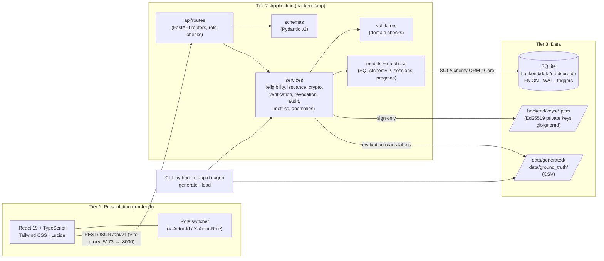
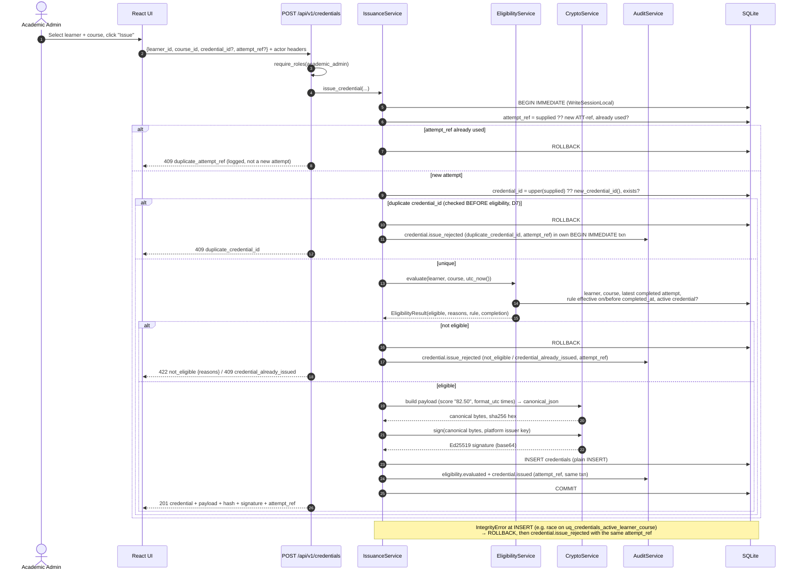
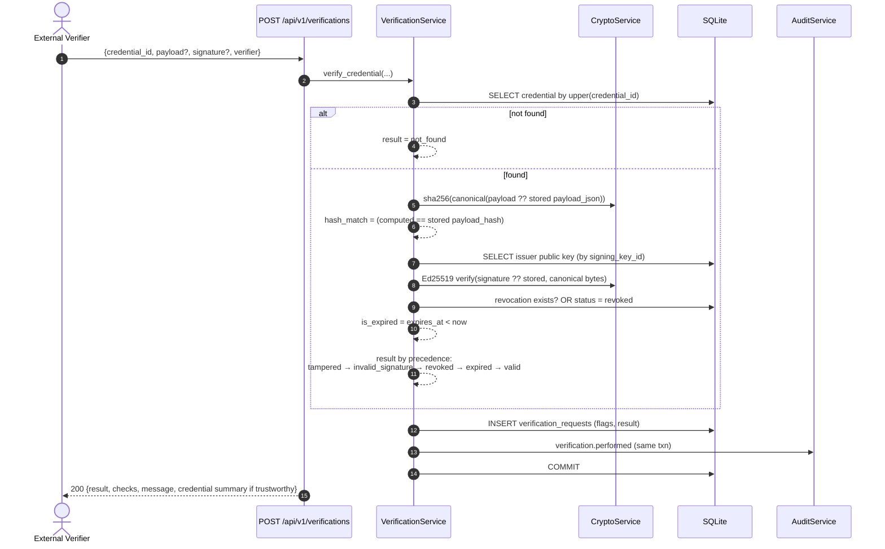
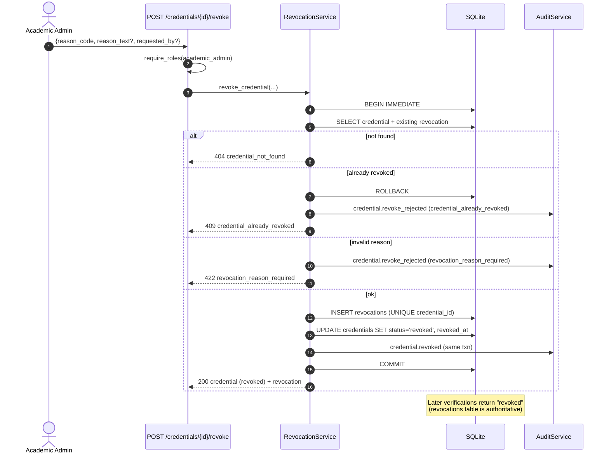
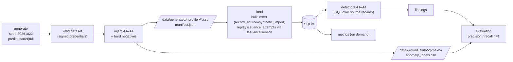

# CredSure: Architecture

## 1. Overview

CredSure is a **three-tier modular monolith** that runs entirely on a local Windows machine.
It has one FastAPI process, one SQLite file and one Vite-served React application. There is no
Docker, message broker, PostgreSQL or cloud dependency. Decisions are recorded in
[architecture_decisions.md](architecture_decisions.md).

## 2. Three-tier architecture



**Tier boundaries:**
- The frontend never touches the database or keys. It only calls the REST API.
- Routers stay thin: they validate input, check the role and call one service function. Business rules live only in services and validators, so the API, the CLI loader and the tests share the same logic.
- Only `services/crypto` reads private keys. Only `services/anomalies/evaluation` reads ground truth.

## 3. Backend module layout

This layout extends the existing structure from Task 01. Files marked † are new; this task
creates none of them.

```
backend/app/
├── main.py                     (exists) app factory, CORS, logging, error handlers
├── core/
│   ├── config.py               (exists) + signing_key_dir (platform), synthetic_key_dir, data_dir settings †
│   ├── errors.py               (exists) + DomainError handler, IntegrityError → domain-code map (D3) †
│   ├── security.py †           Actor dependency: parse headers, require_roles(...)
│   └── timeutil.py †           utc_now, to_utc, format_utc, parse_utc: the only time helpers (D2)
├── database/
│   ├── base.py                 (exists)
│   ├── session.py              (exists) + recursive_triggers, isolation_level=None, begin event,
│   │                           WriteSessionLocal (BEGIN IMMEDIATE) / SessionLocal (BEGIN) (D3) †
│   ├── types.py †              UTCDateTime (whole-second UTC, 'YYYY-MM-DD HH:MM:SS') (D2)
│   └── triggers.py †           CREATE/DROP statements for the 16 triggers + 2 indexes (data_dictionary §6)
├── models/ †                   issuer.py, learner.py, course.py, credential_rule.py,
│                               completion_record.py, credential.py, revocation.py,
│                               verification_request.py, audit_event.py, enums.py
├── schemas/ †                  one module per resource (Create / Update / Read models)
├── validators/ †               completion.py, rule.py, ids.py (formats, normalisation)
├── services/ †
│   ├── crypto.py               canonical_json(), sha256_hex(), sign(), verify(), key loading
│   ├── ids.py                  next_sequence_id(), new_credential_id()
│   ├── audit.py                record_event() with hash chain; verify_chain()
│   ├── eligibility.py          evaluate(learner_id, course_id, at) -> EligibilityResult
│   ├── issuance.py             issue_credential(...)
│   ├── verification.py         verify_credential(...)
│   ├── revocation.py           revoke_credential(...)
│   ├── master_data.py          issuers, learners, courses, rules, completions
│   ├── metrics.py              summary() via SQL aggregates
│   └── anomalies/              detectors.py (A1–A4), evaluation.py
├── api/routes/ †               issuers, learners, courses, rules, completions,
│                               eligibility, credentials, verifications, audit,
│                               metrics, anomalies  (+ existing health.py)
└── datagen/ †                  __main__.py (CLI), config.py (profiles), generator.py,
                                injector.py, loader.py
```

Dependencies point one way: `api → services → (validators, models, database)`. Services
never import from `api`.

## 4. Cross-cutting design

| Concern | Design |
|---------|--------|
| Transactions (D3) | Each connection runs `foreign_keys=ON`, `journal_mode=WAL`, `busy_timeout=30000` and `recursive_triggers=ON`. The driver's implicit transactions are disabled (`isolation_level=None`), and the engine `begin` event emits `BEGIN IMMEDIATE` for `WriteSessionLocal` and `BEGIN` for `SessionLocal`. Every write-critical operation uses `WriteSessionLocal`, so its reads, ID allocation and inserts happen under one write lock. Success audit events are inserted in the same transaction. See [ADR-019](architecture_decisions.md#adr-019-sqlite-transaction-configuration). |
| Rejection auditing | On a `DomainError`, or an `IntegrityError` at insert, the transaction rolls back. The audit service then writes the `*_rejected` event in a new `BEGIN IMMEDIATE` transaction, carrying the same `attempt_ref` for issuance (D7). |
| Errors | Services raise `DomainError(code, http_status, message, details)`. One handler converts it to the existing envelope. Plain `INSERT` only: no `INSERT OR REPLACE`, upsert or `merge()` on immutable or audit-sensitive tables. `IntegrityError`s are mapped by constraint or trigger name ([exception_catalogue §1.7](exception_catalogue.md#17-database-constraint-mapping)). |
| Authorisation | `Actor` dependency from headers, plus `require_roles(...)` per route. Ownership checks (learner's own records, instructor's course) happen in services. Denials write `access.denied`. |
| Cryptography | Canonical JSON → SHA-256 (`hashlib`) → Ed25519 (`cryptography.hazmat.primitives.asymmetric.ed25519`). One shared implementation is used by the API, the generator and the detectors. `canonical_json()` rejects floats; scores are fixed-point strings (D6). |
| Keys (D8) | Platform keys: `backend/keys/platform/<signing_key_id>.pem`, created in exclusive mode and never overwritten. Synthetic keys: `backend/keys/synthetic/<profile>/`. Both are PKCS8, unencrypted for local development, and git-ignored. The directory is chosen by the issuer's `record_source`. The generator writes only to the synthetic directory. The issuer row stores only the public key. |
| Immutability (D1) | 16 SQLite triggers from `database/triggers.py` ([data_dictionary §6](data_dictionary.md#6-reference-ddl-triggers-and-expression-indexes)):<br>• `audit_events`: append-only plus chain link<br>• `revocations`, `verification_requests`: no UPDATE/DELETE<br>• `credentials`: no DELETE; only `active → revoked` with a matching revocation<br>• `issuers`: no DELETE; only `active → retired`<br>• `credential_rules`: criteria frozen after activation; effective-date guard<br>• `completion_records`: locked while an active credential references them<br>A migration test asserts the trigger inventory. |
| Audit chain (D4) | Linear chain enforced by `AUTOINCREMENT`, `UNIQUE(previous_hash)`, the single-genesis index and `trg_audit_events_chain_link`. Audit writes happen only inside `BEGIN IMMEDIATE` transactions that read the head in the same transaction. |
| Time (D2) | All timestamps are UTC with whole seconds, via `core/timeutil.py`. `utc_now()` is the injectable clock, so tests, the generator and the replay are deterministic. Storage text is `YYYY-MM-DD HH:MM:SS`. The wire and payload format is `YYYY-MM-DDTHH:MM:SSZ`. |
| Logging | Existing root logger. Log IDs and result codes, never payload personal data or keys. |
| Performance | Indexes listed in the data dictionary. Bulk load uses SQLAlchemy Core `insert()` with `executemany` in one transaction per file. Detectors are set-based SQL. |

## 5. Key workflows

### 5.1 Credential issuance



### 5.2 Third-party verification



### 5.3 Revocation



Revocation is atomic and irreversible (D1). The three writes in the `ok` branch commit together.
`trg_credentials_status_transition` accepts only `active → revoked`, and only when the matching
revocation row (same `revoked_at`) already exists in the transaction. Every later attempt to
change the status is rejected by the database.

### 5.4 Synthetic data, anomaly detection and evaluation



## 6. Frontend structure (target)

```
frontend/src/
├── api/client.ts          fetch wrapper: base '/api/v1', actor headers, error envelope → typed error
├── api/types.ts           TypeScript types mirroring the API schemas
├── context/ActorContext   current role + actor ID (role switcher, persisted in localStorage)
├── components/            Layout, NavBar, RoleSwitcher, StatusBadge, ResultBanner, DataTable, JsonViewer
└── pages/
    ├── Dashboard.tsx         metrics cards + verification results breakdown
    ├── IssueCredential.tsx   learner/course pickers → eligibility checklist → issue
    ├── CredentialDetail.tsx  payload, hash, signature, revoke dialog, audit trail
    ├── Verify.tsx            public form: credential ID ± pasted payload JSON
    ├── Anomalies.tsx         run detectors, findings table, evaluation metrics
    └── AuditLog.tsx          filterable event list + chain status (S)
```

Navigation uses simple state-based routing (no router dependency) unless `react-router` is
explicitly approved. That keeps to "no unnecessary dependencies" ([ADR-015](architecture_decisions.md#adr-015-frontend-minimal-dependencies-and-state-based-navigation)).

## 7. Security model (MVP)

| Threat | Mitigation |
|--------|------------|
| Payload tampering by holder or verifier | Hash and signature checks (BR-11). Altered data is never echoed back as valid. |
| Database tampering of payloads | Immutability triggers stop application-level edits. The **Ed25519 signature**, checked against `issuers.public_key` on every verification, is the integrity control. The stored hash is only a fast consistency check, because someone who edits the file can change both payload and hash. |
| Audit history rewrite | Append-only triggers (`recursive_triggers=ON` closes the REPLACE bypass), a database-enforced linear hash chain, and the `verify-chain` endpoint. **Limit (D4):** this detects application-level tampering, but not an attacker with unrestricted file access, who can rewrite or truncate the whole chain or restore an older file. |
| Key leakage | Keys only in git-ignored files. Never in the database, logs or responses. |
| Synthetic key misuse (D8) | Synthetic issuers use `ISS-9nn` and `backend/keys/synthetic/<profile>/`. The generator never touches platform keys. Synthetic keys are seed-derived and forgeable: development only. |
| Privilege misuse | Role map plus separation of duties: Platform Admin cannot issue or revoke; Academic Admin cannot manage keys. Denials are audited. |
| Spoofed actor headers | **Accepted risk** for a local demo (AS-01). It would be replaced by real authentication (OIDC/JWT) in production. |
