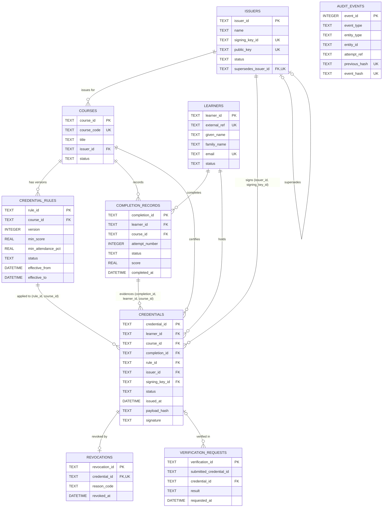

# CredSure: Data Dictionary

These tables are the target schema for the first Alembic migration (`0001`). **The tables are
not created yet.** All types are SQLite-compatible and map directly to SQLAlchemy 2.x
`Mapped[...]` columns.

> **Decision status:** this version includes the pre-T02 decisions D1–D8
> ([ADR-017 – ADR-024](architecture_decisions.md#pre-t02-decisions-d1d8)). The constraint set is
> **final for migration 0001** (D1). SQLite cannot alter constraints later without a table
> rebuild that drops triggers.

## 1. Conventions

| Topic | Convention |
|-------|------------|
| Table names | Plural snake_case (`credential_rules`) |
| Primary keys | Prefixed business IDs stored as `TEXT` (e.g. `LRN-0000001`), except `audit_events.event_id` (`INTEGER PRIMARY KEY AUTOINCREMENT`). See [ADR-003](architecture_decisions.md#adr-003-prefixed-text-business-ids-as-primary-keys). |
| Enumerations | `String(n)` plus a named `CheckConstraint`. Python side: `class X(str, Enum)` (Python 3.10 has no `StrEnum`). |
| Constraint names | Follow `NAMING_CONVENTION` in `backend/app/database/base.py`. **Every `CheckConstraint` must be given an explicit `name`**, or autogenerate fails. The names in this document are final names (the convention adds the `ck_<table>_` prefix to the given name). Partial and expression indexes are named explicitly. |
| Timestamps (D2) | **UTC, whole seconds.** `UTCDateTime` TypeDecorator over SQLite `DATETIME`. It stores the text `YYYY-MM-DD HH:MM:SS` (no microseconds), rejects naive values on bind, and returns aware UTC. The only wire and payload format is `YYYY-MM-DDTHH:MM:SSZ`, produced by `app/core/timeutil.format_utc` and parsed by `parse_utc`. See [ADR-018](architecture_decisions.md#adr-018-whole-second-utc-timestamps-with-one-shared-formatter-and-parser). |
| Booleans | `Boolean` → SQLite `INTEGER` 0/1 |
| Decimals | `Float` → SQLite `REAL`, rounded to 2 dp on write. Never serialised as a float into a signed payload (D6). |
| JSON text | `Text` holding canonical JSON strings (not the `JSON` type), so the bytes stay unchanged |
| Foreign keys | `ON DELETE RESTRICT`, `ON UPDATE RESTRICT`. Enforced by `PRAGMA foreign_keys=ON`. |
| Write transactions (D3) | Every write uses `WriteSessionLocal` (`BEGIN IMMEDIATE`). No `INSERT OR REPLACE`, `INSERT OR IGNORE`, upsert or `Session.merge()` on immutable or audit-sensitive tables. See [ADR-019](architecture_decisions.md#adr-019-sqlite-transaction-configuration). |
| `record_source` | `platform` (created through the API) or `synthetic_import` (loaded by the data loader) on every business table |

### ID formats

| Entity | Pattern | Example | Generated by |
|--------|---------|---------|--------------|
| Issuer (platform) | `ISS-\d{3}`, range 001–899 | `ISS-001` | sequence (never allocates ≥ 900) |
| Issuer (synthetic, D8) | `ISS-9\d\d`, range 901–999 | `ISS-901` | generator |
| Signing key | `<issuer_id>-K\d+`. Always `-K1` in the MVP, because a new key creates a new issuer row (ADR-006). | `ISS-001-K1` | issuer creation |
| Learner | `LRN-\d{7}` | `LRN-0000042` | sequence |
| Course | `CRS-\d{5}` | `CRS-00017` | sequence |
| Credential rule | `RUL-\d{5}-V\d+`, derived from `course_id` and `version` (CHECK) | `RUL-00017-V2` | derived |
| Completion record | `CMP-\d{7}` | `CMP-0001234` | sequence |
| Credential | `CRED-[0-9A-HJKMNP-TV-Z]{12}` | `CRED-7K2M9QXR4T1B` | `secrets` (platform) / seeded RNG (generator) |
| Revocation | `REV-\d{6}` | `REV-000031` | sequence |
| Verification request | `VER-\d{7}` | `VER-0000007` | sequence |
| Issuance attempt reference (D7) | Platform: `ATT-[0-9A-HJKMNP-TV-Z]{12}`. Synthetic: `ATT-\d{6}`. | `ATT-7K2M9QXR4T1B`, `ATT-000004` | `secrets` (platform) / generator |

Sequence IDs come from `MAX(id)+1`, read **inside** the `BEGIN IMMEDIATE` write transaction that
inserts the row (D3).

## 2. Entity relationship diagram



`AUDIT_EVENTS` has no foreign keys. It references any entity polymorphically through
`(entity_type, entity_id)`, so audit rows survive independently and never block other writes.

### Relationship summary

| Parent | Child | Cardinality | FK column(s) | Notes |
|--------|-------|-------------|--------------|-------|
| issuers | courses | 1 : N | `courses.issuer_id` | Issuer used for new credentials of the course |
| issuers | credentials | 1 : N | `credentials (issuer_id, signing_key_id)` → `issuers (issuer_id, signing_key_id)` | Composite (D1). The signing key must belong to the issuer. Historical: never changes after issuance. |
| issuers | issuers | 0..1 : 0..1 | `issuers.supersedes_issuer_id` (UNIQUE) | Linear version history; an issuer is superseded at most once |
| courses | credential_rules | 1 : N | `credential_rules.course_id` | Max one `active` |
| courses | completion_records | 1 : N | `completion_records.course_id` | |
| courses | credentials | 1 : N | `credentials.course_id` | |
| learners | completion_records | 1 : N | `completion_records.learner_id` | |
| learners | credentials | 1 : N | `credentials.learner_id` | Max one `active` per course |
| completion_records | credentials | 1 : 0..N | `credentials (completion_id, learner_id, course_id)` → `completion_records (completion_id, learner_id, course_id)` | Composite (D1). The evidence belongs to the same learner and course. N > 1 only after revoke and re-issue. |
| credential_rules | credentials | 1 : N | `credentials (rule_id, course_id)` → `credential_rules (rule_id, course_id)` | Composite (D1). The applied rule belongs to the same course. |
| credentials | revocations | 1 : 0..1 | `revocations.credential_id` (UNIQUE) | |
| credentials | verification_requests | 1 : 0..N | `verification_requests.credential_id` (nullable) | NULL exactly when `result = 'not_found'` |

The composite FKs **replace** the single-column FKs on `credentials.completion_id`, `rule_id`
and `issuer_id`/`signing_key_id`. Do not declare both, or the generated FK names clash. The
separate `credentials.learner_id → learners` and `credentials.course_id → courses` FKs remain.

## 3. Tables

Column legend: **Null** = nullable. **Key**: PK, FK, UK (unique), IX (indexed). Table-level
constraints are listed under each table with their final names. Triggers and expression indexes
are in §6.

### 3.1 `issuers`

| Column | SQLAlchemy type | SQLite | Null | Key / constraint | Description |
|--------|-----------------|--------|:----:|------------------|-------------|
| issuer_id | String(20) | TEXT | N | PK | Issuer identifier |
| name | String(200) | TEXT | N | | Display name used in payloads |
| legal_name | String(200) | TEXT | N | | Registered institution name |
| country_code | String(2) | TEXT | Y | | ISO 3166-1 alpha-2 |
| website_url | String(500) | TEXT | Y | | |
| signing_key_id | String(64) | TEXT | N | UK | Key identifier; private key file name |
| public_key | String(100) | TEXT | N | UK | Base64 (RFC 4648, padded) of the 32-byte raw Ed25519 public key |
| key_algorithm | String(20) | TEXT | N | CHECK = `'Ed25519'` | |
| status | String(20) | TEXT | N | default `active` | |
| supersedes_issuer_id | String(20) | TEXT | Y | FK → issuers.issuer_id; **UK** | Previous version of this issuer |
| valid_from | UTCDateTime | TEXT | N | | |
| valid_to | UTCDateTime | TEXT | Y | | Set on retirement |
| record_source | String(20) | TEXT | N | | |
| created_by | String(64) | TEXT | N | | Actor ID |
| created_at | UTCDateTime | TEXT | N | | |

Table-level constraints:
- `uq_issuers_issuer_id`: UNIQUE (`issuer_id`, `signing_key_id`). Composite FK target.
- `uq_issuers_supersedes_issuer_id`: UNIQUE (`supersedes_issuer_id`).
- `ck_issuers_issuer_id_format`: `issuer_id GLOB 'ISS-[0-9][0-9][0-9]'`.
- `ck_issuers_synthetic_range` (D8): `(record_source = 'synthetic_import') = (issuer_id GLOB 'ISS-9[0-9][0-9]')`.
- `ck_issuers_signing_key_id_format`: `signing_key_id GLOB issuer_id || '-K[0-9]*'`.
- `ck_issuers_no_self_supersede`: `supersedes_issuer_id IS NULL OR supersedes_issuer_id <> issuer_id`.
- `ck_issuers_status`: `status IN ('active','retired')`.
- `ck_issuers_retired_valid_to`: `(status = 'retired') = (valid_to IS NOT NULL)`.
- `ck_issuers_valid_window`: `valid_to IS NULL OR valid_to > valid_from`.
- `ck_issuers_key_algorithm`, `ck_issuers_record_source`: enumerations.
- Triggers: `trg_issuers_immutable` (only `active → retired` with `valid_to`), `trg_issuers_no_delete`.

### 3.2 `learners`

| Column | SQLAlchemy type | SQLite | Null | Key / constraint | Description |
|--------|-----------------|--------|:----:|------------------|-------------|
| learner_id | String(20) | TEXT | N | PK | Immutable identity (BR-01) |
| external_ref | String(50) | TEXT | Y | UK | Institution student number |
| given_name | String(100) | TEXT | N | | |
| family_name | String(100) | TEXT | N | IX (`family_name`, `given_name`) | |
| email | String(254) | TEXT | N | UK | Stored lower-case |
| status | String(20) | TEXT | N | default `active` | |
| record_source | String(20) | TEXT | N | | |
| created_at | UTCDateTime | TEXT | N | | |
| updated_at | UTCDateTime | TEXT | N | | |

Table-level constraints:
- `ck_learners_learner_id_format`: `learner_id GLOB 'LRN-[0-9][0-9][0-9][0-9][0-9][0-9][0-9]'`.
- `ck_learners_email_lower`: `email = lower(email)`.
- `ck_learners_status` (`active`, `inactive`), `ck_learners_record_source`.

### 3.3 `courses`

| Column | SQLAlchemy type | SQLite | Null | Key / constraint | Description |
|--------|-----------------|--------|:----:|------------------|-------------|
| course_id | String(20) | TEXT | N | PK | |
| course_code | String(20) | TEXT | N | UK | e.g. `DATA-101` |
| title | String(200) | TEXT | N | | |
| description | Text | TEXT | Y | | |
| credit_hours | Integer | INTEGER | Y | CHECK `>= 0` | |
| issuer_id | String(20) | TEXT | N | FK → issuers; IX | Current issuer for new credentials |
| lead_instructor_id | String(64) | TEXT | Y | IX | Instructor actor ID (AS-10) |
| status | String(20) | TEXT | N | default `active` | |
| record_source | String(20) | TEXT | N | | |
| created_at | UTCDateTime | TEXT | N | | |
| updated_at | UTCDateTime | TEXT | N | | |

Table-level constraints:
- `ck_courses_course_id_format`: `course_id GLOB 'CRS-[0-9][0-9][0-9][0-9][0-9]'`.
- `ck_courses_status` (`active`, `archived`), `ck_courses_credit_hours`, `ck_courses_record_source`.

### 3.4 `credential_rules`

| Column | SQLAlchemy type | SQLite | Null | Key / constraint | Description |
|--------|-----------------|--------|:----:|------------------|-------------|
| rule_id | String(30) | TEXT | N | PK | `RUL-<course#>-V<version>` (derived, CHECK) |
| course_id | String(20) | TEXT | N | FK → courses | |
| version | Integer | INTEGER | N | CHECK `>= 1` | |
| credential_type | String(20) | TEXT | N | CHECK in (`certificate`,`badge`) | |
| min_score | Float | REAL | Y | CHECK 0–100 | NULL = no score requirement |
| min_attendance_pct | Float | REAL | Y | CHECK 0–100 | NULL = no attendance requirement |
| validity_days | Integer | INTEGER | Y | CHECK `> 0` | NULL = never expires |
| status | String(20) | TEXT | N | CHECK in (`draft`,`active`,`retired`) | |
| effective_from | UTCDateTime | TEXT | Y | | NULL exactly while `draft`. Set on activation; may be backdated (D5). |
| effective_to | UTCDateTime | TEXT | Y | | Set when superseded |
| description | Text | TEXT | Y | | Human-readable criteria |
| created_by | String(64) | TEXT | N | | |
| created_at | UTCDateTime | TEXT | N | | |
| activated_at | UTCDateTime | TEXT | Y | | Wall-clock activation time (may differ from a backdated `effective_from`) |
| record_source | String(20) | TEXT | N | | |

Table-level constraints:
- `uq_credential_rules_course_id`: UNIQUE (`course_id`, `version`).
- `uq_credential_rules_rule_id`: UNIQUE (`rule_id`, `course_id`). Composite FK target.
- `uq_credential_rules_active_course`: partial unique index on (`course_id`) `WHERE status = 'active'`.
- `ck_credential_rules_rule_id_derived`: `rule_id = 'RUL-' || substr(course_id, 5) || '-V' || version`.
- `ck_credential_rules_draft_effective_from`: `(status = 'draft') = (effective_from IS NULL)`.
- `ck_credential_rules_retired_effective_to`: `status <> 'retired' OR effective_to IS NOT NULL`.
- `ck_credential_rules_active_open`: `status <> 'active' OR effective_to IS NULL`.
- `ck_credential_rules_has_criteria`: `status = 'draft' OR min_score IS NOT NULL OR min_attendance_pct IS NOT NULL`.
- `ck_credential_rules_window`: `effective_to IS NULL OR effective_to > effective_from`. When v2 is activated, this also forces its `effective_from` to be later than v1's.
- Triggers:
  - `trg_credential_rules_immutable`: criteria frozen once non-draft; transitions only `draft → active → retired`.
  - `trg_credential_rules_effective_date_guard_update` and `_insert` (D5): reject activating, or inserting, a non-draft rule when a recorded completion of the course has `completed_at ≥ effective_from`.

### 3.5 `completion_records`

| Column | SQLAlchemy type | SQLite | Null | Key / constraint | Description |
|--------|-----------------|--------|:----:|------------------|-------------|
| completion_id | String(20) | TEXT | N | PK | |
| learner_id | String(20) | TEXT | N | FK → learners; IX (`learner_id`,`course_id`) | |
| course_id | String(20) | TEXT | N | FK → courses; IX | |
| attempt_number | Integer | INTEGER | N | CHECK `>= 1` | |
| status | String(20) | TEXT | N | CHECK in (`in_progress`,`completed`,`failed`,`withdrawn`) | |
| score | Float | REAL | Y | CHECK 0–100 | Final assessment score, rounded to 2 dp |
| attendance_pct | Float | REAL | Y | CHECK 0–100 | |
| completed_at | UTCDateTime | TEXT | Y | | Determines the applicable rule (D5) |
| assessed_by | String(64) | TEXT | Y | | Instructor actor ID |
| recorded_at | UTCDateTime | TEXT | N | | |
| updated_at | UTCDateTime | TEXT | N | | |
| record_source | String(20) | TEXT | N | | |

Table-level constraints:
- `uq_completion_records_attempt`: UNIQUE (`learner_id`, `course_id`, `attempt_number`).
- `uq_completion_records_completion_id`: UNIQUE (`completion_id`, `learner_id`, `course_id`). Composite FK target.
- `ck_completion_records_completed_at`: `status <> 'completed' OR completed_at IS NOT NULL`.
- `ck_completion_records_recorded_after`: `completed_at IS NULL OR completed_at <= recorded_at`.
- Range and enumeration checks as listed in the table.
- Trigger: `trg_completion_records_locked` (BR-20; no update while an active credential references the record).

### 3.6 `credentials`

| Column | SQLAlchemy type | SQLite | Null | Key / constraint | Description |
|--------|-----------------|--------|:----:|------------------|-------------|
| credential_id | String(30) | TEXT | N | PK | BR-02 |
| learner_id | String(20) | TEXT | N | FK → learners; IX | |
| course_id | String(20) | TEXT | N | FK → courses; IX | |
| completion_id | String(20) | TEXT | N | composite FK; IX | Eligibility evidence |
| rule_id | String(30) | TEXT | N | composite FK; IX | Applied rule version |
| issuer_id | String(20) | TEXT | N | composite FK; IX | Issuer at issuance (historical) |
| credential_type | String(20) | TEXT | N | CHECK in (`certificate`,`badge`) | Copied from rule |
| status | String(20) | TEXT | N | default `active`; IX | Denormalised (C-07). Only `active → revoked` (D1). |
| issued_at | UTCDateTime | TEXT | N | IX | Equal to payload `issued_at` (D2) |
| expires_at | UTCDateTime | TEXT | Y | | |
| revoked_at | UTCDateTime | TEXT | Y | | Equal to `revocations.revoked_at` |
| payload_json | Text | TEXT | N | | Exact canonical JSON string (§4) |
| payload_hash | String(64) | TEXT | N | IX | SHA-256 lowercase hex |
| signature | String(100) | TEXT | N | | Base64 Ed25519 signature (88 characters) |
| signing_key_id | String(64) | TEXT | N | composite FK | Must belong to `issuer_id` |
| schema_version | String(10) | TEXT | N | default `'1.0'` | |
| issued_by | String(64) | TEXT | N | | Actor ID |
| record_source | String(20) | TEXT | N | | |
| created_at | UTCDateTime | TEXT | N | | |

Table-level constraints:
- `fk_credentials_completion_id_completion_records`: (`completion_id`, `learner_id`, `course_id`) → `completion_records`.
- `fk_credentials_rule_id_credential_rules`: (`rule_id`, `course_id`) → `credential_rules`.
- `fk_credentials_issuer_id_issuers`: (`issuer_id`, `signing_key_id`) → `issuers`.
- `uq_credentials_active_learner_course`: partial unique index on (`learner_id`, `course_id`) `WHERE status = 'active'` (BR-05).
- `ck_credentials_credential_id_format`: `credential_id GLOB 'CRED-'` followed by 12 × `[0-9A-HJKMNP-TV-Z]` (full text in §6). This implies upper case.
- `ck_credentials_payload_hash_format`: `length(payload_hash) = 64 AND payload_hash NOT GLOB '*[^0-9a-f]*'`.
- `ck_credentials_signature_length`: `length(signature) = 88`.
- `ck_credentials_status`: `status IN ('active','revoked')`.
- `ck_credentials_revoked_at`: `(status = 'revoked') = (revoked_at IS NOT NULL)`.
- `ck_credentials_expiry`: `expires_at IS NULL OR expires_at > issued_at`.
- Triggers:
  - `trg_credentials_immutable`: every column except `status` and `revoked_at` is frozen.
  - `trg_credentials_status_transition`: only `active → revoked`, with a matching revocation row and `revoked_at`. **No reinstatement.**
  - `trg_credentials_no_delete`.

### 3.7 `revocations`

| Column | SQLAlchemy type | SQLite | Null | Key / constraint | Description |
|--------|-----------------|--------|:----:|------------------|-------------|
| revocation_id | String(20) | TEXT | N | PK | |
| credential_id | String(30) | TEXT | N | FK → credentials; **UK** | One revocation per credential |
| reason_code | String(30) | TEXT | N | CHECK in (`issued_in_error`,`academic_misconduct`,`learner_request`,`data_correction`,`fraud`,`other`) | |
| reason_text | Text | TEXT | Y | CHECK `reason_code <> 'other' OR reason_text IS NOT NULL` | |
| requested_by | String(64) | TEXT | Y | | e.g. the support staff member who raised it (AS-08) |
| approved_by | String(64) | TEXT | N | | Academic admin actor ID |
| revoked_at | UTCDateTime | TEXT | N | IX | Effective instant; copied to `credentials.revoked_at` |
| record_source | String(20) | TEXT | N | | |
| created_at | UTCDateTime | TEXT | N | | |

- **Atomic revocation (D1):** in one `BEGIN IMMEDIATE` transaction, insert this row, then update the credential `active → revoked`, then insert the audit event.
- Triggers: `trg_revocations_no_update`, `trg_revocations_no_delete`.

### 3.8 `verification_requests`

| Column | SQLAlchemy type | SQLite | Null | Key / constraint | Description |
|--------|-----------------|--------|:----:|------------------|-------------|
| verification_id | String(20) | TEXT | N | PK | |
| submitted_credential_id | String(64) | TEXT | N | IX | Raw input, kept even if unknown |
| credential_id | String(30) | TEXT | Y | FK → credentials; IX (`credential_id`, `requested_at`) | Resolved credential (NULL iff `not_found`) |
| verifier_name | String(200) | TEXT | N | | |
| verifier_organization | String(200) | TEXT | Y | | |
| verifier_email | String(254) | TEXT | Y | | |
| purpose | String(30) | TEXT | Y | CHECK in (`employment`,`admission`,`licensing`,`other`) | |
| channel | String(20) | TEXT | N | CHECK in (`api`,`portal`) | |
| presented_payload_hash | String(64) | TEXT | Y | | SHA-256 of the presented payload; NULL for lookup-only |
| hash_match | Boolean | INTEGER | Y | | NULL only when `not_found` |
| signature_valid | Boolean | INTEGER | Y | | |
| is_revoked | Boolean | INTEGER | Y | | |
| is_expired | Boolean | INTEGER | Y | | |
| result | String(20) | TEXT | N | IX | Precedence BR-13 |
| requested_at | UTCDateTime | TEXT | N | IX | |
| responded_at | UTCDateTime | TEXT | Y | | |
| record_source | String(20) | TEXT | N | | |

Table-level constraints (D1):
- `ck_verification_requests_flags_present`: `credential_id IS NULL OR (hash_match IS NOT NULL AND signature_valid IS NOT NULL AND is_revoked IS NOT NULL AND is_expired IS NOT NULL)`.
- `ck_verification_requests_result_precedence`: `result = CASE WHEN credential_id IS NULL THEN 'not_found' WHEN hash_match = 0 THEN 'tampered' WHEN signature_valid = 0 THEN 'invalid_signature' WHEN is_revoked = 1 THEN 'revoked' WHEN is_expired = 1 THEN 'expired' ELSE 'valid' END`.
- Triggers: `trg_verification_requests_no_update`, `trg_verification_requests_no_delete`.

The stored result is always the BR-13 function of the stored flags. Anomalies A3 and A4 are
stored as wrong *flags* (see [exception_catalogue §3](exception_catalogue.md#3-data-anomaly-catalogue)).

### 3.9 `audit_events`

| Column | SQLAlchemy type | SQLite | Null | Key / constraint | Description |
|--------|-----------------|--------|:----:|------------------|-------------|
| event_id | Integer | INTEGER | N | PK `AUTOINCREMENT` (`sqlite_autoincrement=True`) | Global order (D4) |
| event_uuid | String(36) | TEXT | N | UK | UUID4 for external reference |
| event_type | String(50) | TEXT | N | IX (`event_type`, `reason_code`) | See the list below |
| entity_type | String(30) | TEXT | N | IX (`entity_type`,`entity_id`) | `learner`, `course`, `issuer`, `rule`, `completion`, `credential`, `revocation`, `verification`, `dataset`, `anomaly_run`, `audit` |
| entity_id | String(64) | TEXT | N | | |
| actor_id | String(64) | TEXT | N | | `system` for automated events |
| actor_role | String(30) | TEXT | N | | Role code or `system` |
| outcome | String(20) | TEXT | N | CHECK in (`success`,`rejected`,`error`) | |
| reason_code | String(50) | TEXT | Y | | Error code for rejections |
| attempt_ref | String(30) | TEXT | Y | see constraints | Issuance attempt reference (D7) |
| details_json | Text | TEXT | N | default `'{}'` | Canonical JSON: IDs, hashes, before/after values. No secrets. |
| occurred_at | UTCDateTime | TEXT | N | IX | |
| previous_hash | String(64) | TEXT | Y | **UK** | `event_hash` of the previous event; NULL only for the single genesis event |
| event_hash | String(64) | TEXT | N | UK | See the definition below |

Table-level constraints:
- `uq_audit_events_previous_hash`: UNIQUE (`previous_hash`). No two events extend the same predecessor (D4).
- `uq_audit_events_single_genesis`: expression index on `ifnull(previous_hash, 'GENESIS')`. Exactly one genesis event (D4; §6).
- `uq_audit_events_attempt_outcome`: partial unique index on (`attempt_ref`) `WHERE event_type IN ('credential.issued','credential.issue_rejected')`. **At most one** terminal outcome per attempt (D7). That every recorded attempt receives one is ensured by the application's transaction logic, not by the database.
- `ck_audit_events_attempt_ref_required`: `event_type NOT IN ('credential.issued','credential.issue_rejected') OR attempt_ref IS NOT NULL`.
- `ck_audit_events_attempt_ref_format`: `attempt_ref IS NULL OR attempt_ref GLOB 'ATT-[0-9A-HJKMNP-TV-Z]*'`.
- `ck_audit_events_outcome`.
- Triggers: `trg_audit_events_no_update`, `trg_audit_events_no_delete`, `trg_audit_events_chain_link` (D4).

**Event hash (D4, [ADR-020](architecture_decisions.md#adr-020-database-enforced-linear-audit-chain)):**

```
event_hash = sha256_hex(canonical_json({
    "previous_hash": <hex or null>, "event_uuid": ..., "event_type": ..., "entity_type": ...,
    "entity_id": ..., "actor_id": ..., "actor_role": ..., "outcome": ..., "reason_code": <str or null>,
    "attempt_ref": <str or null>, "details_json": <stored canonical string>, "occurred_at": format_utc(...)
}))
```

Audit rows are inserted only inside a `BEGIN IMMEDIATE` transaction that reads the current head
(`ORDER BY event_id DESC LIMIT 1`) in the same transaction. The chain detects application-level
tampering. It does not protect against an attacker with unrestricted access to the database file.

**Event types:**

| Event type | Entity | When |
|------------|--------|------|
| `issuer.created`, `issuer.retired` | issuer | Issuer changes |
| `learner.created`, `learner.updated` | learner | |
| `course.created`, `course.updated` | course | |
| `rule.created`, `rule.updated`, `rule.activated`, `rule.retired` | rule | `rule.updated` only for drafts. `rule.activated` records `effective_from`, `activated_at` and the retired predecessor. |
| `completion.recorded`, `completion.corrected`, `completion.correction_rejected` | completion | `completion.corrected` records before and after values, including `applicable_rule_id` (D5) |
| `eligibility.evaluated` | credential (target `learner_id:course_id`) | During issuance; carries `attempt_ref` |
| `credential.issued`, `credential.issue_rejected` | credential | Terminal event of an issuance attempt. **`attempt_ref` required** (D7). Rejections include `reason_code`, which holds the API error code (`duplicate_credential_id`, `not_eligible`, `credential_already_issued`, …). The internal eligibility reasons (e.g. `already_issued`) go in `details_json.reasons`. |
| `credential.revoked`, `credential.revoke_rejected` | credential | |
| `verification.performed` | verification | Every verification |
| `access.denied` | any | 403 responses |
| `dataset.imported` | dataset | One per imported file (AS-09) |
| `anomaly.run_completed` | anomaly_run | Counts per detector |
| `audit.chain_verified` | audit | Result of a chain check |

## 4. Canonical credential payload

Fields (schema version `1.0`). Types are as listed. **Every key is always present**, with
explicit `null` when empty:

| Field | Type | Source |
|-------|------|--------|
| `schema_version` | string | constant `"1.0"` |
| `credential_id` | string | generated or supplied (upper case) |
| `credential_type` | string | rule |
| `learner_id` | string | learner |
| `learner_name` | string | `given_name + " " + family_name` snapshot (display only, AS-07) |
| `course_id`, `course_code`, `course_title` | string | course |
| `rule_id` | string | applied rule |
| `rule_version` | integer | applied rule |
| `completion_id` | string | completion record |
| `completed_at` | string or null | completion record, `format_utc` (D2) |
| `score` | **string or null** | completion record, fixed-point with 2 decimals, e.g. `"82.50"` (D6) |
| `issuer_id`, `issuer_name`, `signing_key_id` | string | issuer snapshot |
| `issued_at` | string | `format_utc` (D2) |
| `expires_at` | string or null | `format_utc` (D2) |

Canonicalisation rules (BR-08, [ADR-022](architecture_decisions.md#adr-022-fixed-point-decimal-strings-in-signed-payloads)):
- `json.dumps(payload, sort_keys=True, separators=(",", ":"), ensure_ascii=False, allow_nan=False)`, UTF-8 encoded.
- Allowed value types: `str`, `int`, `bool`, `None` (plus `dict`/`list`). **`canonical_json()` raises on any `float`.**
- Timestamps: `YYYY-MM-DDTHH:MM:SSZ`, whole seconds, UTC.
- Score: `Decimal(str(value)).quantize(Decimal("0.01"), rounding=ROUND_HALF_UP)` rendered as a string.
- Base64: RFC 4648 standard alphabet with padding (signature, public key).

Example of a canonical string (keys sorted, no whitespace):

```json
{"completed_at":"2026-03-14T10:00:00Z","completion_id":"CMP-0001234","course_code":"DATA-101","course_id":"CRS-00017","course_title":"Data Foundations","credential_id":"CRED-7K2M9QXR4T1B","credential_type":"certificate","expires_at":null,"issued_at":"2026-03-20T09:30:00Z","issuer_id":"ISS-001","issuer_name":"CredSure Institute of Technology","learner_id":"LRN-0000042","learner_name":"Asha Rao","rule_id":"RUL-00017-V1","rule_version":1,"schema_version":"1.0","score":"82.50","signing_key_id":"ISS-001-K1"}
```

## 5. Synthetic dataset files

Generated under `data/generated/<profile>/` (git-ignored). Ground truth is under
`data/ground_truth/<profile>/`. Synthetic signing keys are written only under
`backend/keys/synthetic/<profile>/` (D8).

### 5.1 Input files

The columns match the table columns above, except for `record_source` and `created_at`/`updated_at`.
All timestamps are written with `format_utc` and read back with `parse_utc` (D2). Files are UTF-8
without BOM, with `\n` line endings.

| File | Rows (full) | Notes |
|------|-------------|-------|
| `issuers.csv` | 6 | **Synthetic range only** (`ISS-901`…, D8). Includes 1 retired issuer with a superseding row. |
| `learners.csv` | 20,000 | Includes ≈2 % name collisions (BR-01) and ≈3 % inactive |
| `courses.csv` | 1,000 | References synthetic issuers only |
| `credential_rules.csv` | ≈1,100 | 10 % of courses have v1 (retired) and v2 (active). Every version is loaded **before** the completions it governs (D5). v1 starts at course creation. |
| `completion_records.csv` | ≈15,000 | ≈10,000 evidence completed records, ≈3,000 completed but not yet issued, ≈2,000 failed, in-progress or withdrawn; ≈5 % second attempts |
| `credentials.csv` | 9,950 | Signed with synthetic keys. Includes 100 A1 mutations. The 50 valid issuance attempts below bring the total to 10,000. |
| `issuance_attempts.csv` | 100 | `attempt_id, credential_id, learner_id, course_id, attempted_at, actor_id`. 50 valid new issuances plus 50 A2 duplicate-ID attempts. `attempt_id` (`ATT-nnnnnn`) is replayed as the `attempt_ref` (D7). |
| `revocations.csv` | ≈300 | |
| `verification_requests.csv` | 5,000 | Mix: ≈87 % valid credential, ≈5 % revoked (correctly answered), ≈2 % tampered presentation (correctly answered), ≈2 % not found, ≈1 % expired, plus 50 A3 and 50 A4 mutations |
| `manifest.json` | 1 | Profile, seed, generator version, row counts, SHA-256 per file. No wall-clock timestamp, so output is byte-identical across runs. |

Load order (FK and D5 order): issuers → learners → courses → credential_rules →
completion_records → credentials (final status) → revocations → verification_requests →
replay `issuance_attempts.csv` through the issuance service.

### 5.2 Ground truth (`anomaly_labels.csv`)

| Column | Type | Description |
|--------|------|-------------|
| `label_id` | TEXT | `GT-000001` |
| `record_type` | TEXT | `credential`, `issuance_attempt` or `verification_request` |
| `record_id` | TEXT | ID in the matching input file (`attempt_id` for issuance attempts) |
| `anomaly_type` | TEXT | `issued_before_completion`, `duplicate_credential_id`, `revoked_verified_as_valid`, `tampered_payload_not_detected` |
| `variant` | TEXT | Sub-case (see [exception_catalogue §3](exception_catalogue.md#3-data-anomaly-catalogue)) |
| `description` | TEXT | Human-readable explanation of the mutation |

Only anomalous records are listed. Any record not listed is normal.

### 5.3 Profiles

| Parameter | `starter` | `full` |
|-----------|----------:|-------:|
| learners / courses | 200 / 20 | 20,000 / 1,000 |
| credentials (total after replay) | 100 | 10,000 |
| verification requests | 50 | 5,000 |
| A1 / A2 / A3 / A4 | 3 / 2 / 2 / 2 | 100 / 50 / 50 / 50 |
| Hard negatives per anomaly type (similar but correct records) | ≥ 2 | ≥ 50 |

Hard negatives make sure detectors check the right conditions. Examples:
- verifications of revoked credentials made **before** `revoked_at` that correctly return `valid`
- tampered presentations that correctly return `tampered`
- credentials issued shortly **after** completion

## 6. Reference DDL: triggers and expression indexes

Migration `0001` creates the tables, columns, CHECKs, UNIQUEs, FKs and partial indexes from the
SQLAlchemy models (§3). The statements below are **not autogenerated**. They live in
`app/database/triggers.py` as `CREATE_STATEMENTS` / `DROP_STATEMENTS`, are applied with
`op.execute` in `upgrade()`, and are dropped first in `downgrade()`. Any later batch migration
on these tables must re-apply them; a test asserts the trigger inventory.

**Validation (2026-11-14):** executed in a scratch database on the bundled SQLite 3.35.5 together
with the §3 constraints:
- 53 scripted cases: 49 passed as written. Three were rejected by `trg_audit_events_chain_link` before the expected unique index fired (still rejected). One was a defect in the test script.
- 5 follow-up cases: the loader insert guard; REPLACE blocked with a correct head hash; second genesis and fork blocked by the indexes alone with the chain trigger removed.
- Verified with a real SQLAlchemy engine: `recursive_triggers=1` per connection, and a second `BEGIN IMMEDIATE` writer blocks while the first holds the lock.
- The SQL block below was then extracted from this document and applied verbatim to tables with the full column sets. All 16 triggers were created, and the issuer immutability cases were re-checked.

T02 must reproduce these as migration tests (ADR-019).

```sql
-- D4: audit chain ------------------------------------------------------------
CREATE UNIQUE INDEX uq_audit_events_single_genesis ON audit_events(ifnull(previous_hash, 'GENESIS'));
CREATE UNIQUE INDEX uq_audit_events_attempt_outcome ON audit_events(attempt_ref)
  WHERE event_type IN ('credential.issued','credential.issue_rejected');            -- D7
CREATE TRIGGER trg_audit_events_no_update BEFORE UPDATE ON audit_events
BEGIN SELECT RAISE(ABORT, 'audit_events is append-only'); END;
CREATE TRIGGER trg_audit_events_no_delete BEFORE DELETE ON audit_events
BEGIN SELECT RAISE(ABORT, 'audit_events is append-only'); END;
CREATE TRIGGER trg_audit_events_chain_link BEFORE INSERT ON audit_events
WHEN NEW.previous_hash IS NOT (SELECT event_hash FROM audit_events ORDER BY event_id DESC LIMIT 1)
BEGIN SELECT RAISE(ABORT, 'audit_events: previous_hash must equal the current chain head'); END;

-- D1: revocations, credentials ------------------------------------------------
CREATE TRIGGER trg_revocations_no_update BEFORE UPDATE ON revocations
BEGIN SELECT RAISE(ABORT, 'revocations are immutable'); END;
CREATE TRIGGER trg_revocations_no_delete BEFORE DELETE ON revocations
BEGIN SELECT RAISE(ABORT, 'revocations are immutable'); END;
CREATE TRIGGER trg_credentials_no_delete BEFORE DELETE ON credentials
BEGIN SELECT RAISE(ABORT, 'credentials cannot be deleted'); END;
CREATE TRIGGER trg_credentials_immutable BEFORE UPDATE ON credentials
WHEN NEW.credential_id IS NOT OLD.credential_id OR NEW.learner_id IS NOT OLD.learner_id
  OR NEW.course_id IS NOT OLD.course_id OR NEW.completion_id IS NOT OLD.completion_id
  OR NEW.rule_id IS NOT OLD.rule_id OR NEW.issuer_id IS NOT OLD.issuer_id
  OR NEW.credential_type IS NOT OLD.credential_type OR NEW.issued_at IS NOT OLD.issued_at
  OR NEW.expires_at IS NOT OLD.expires_at OR NEW.payload_json IS NOT OLD.payload_json
  OR NEW.payload_hash IS NOT OLD.payload_hash OR NEW.signature IS NOT OLD.signature
  OR NEW.signing_key_id IS NOT OLD.signing_key_id OR NEW.schema_version IS NOT OLD.schema_version
  OR NEW.issued_by IS NOT OLD.issued_by OR NEW.record_source IS NOT OLD.record_source
  OR NEW.created_at IS NOT OLD.created_at
BEGIN SELECT RAISE(ABORT, 'credentials: only status and revoked_at may change'); END;
CREATE TRIGGER trg_credentials_status_transition BEFORE UPDATE OF status, revoked_at ON credentials
WHEN NOT (OLD.status = 'active' AND NEW.status = 'revoked'
          AND EXISTS (SELECT 1 FROM revocations r
                      WHERE r.credential_id = NEW.credential_id AND r.revoked_at = NEW.revoked_at))
BEGIN SELECT RAISE(ABORT, 'credentials: only active -> revoked with a matching revocation'); END;

-- D1: issuers -----------------------------------------------------------------
CREATE TRIGGER trg_issuers_no_delete BEFORE DELETE ON issuers
BEGIN SELECT RAISE(ABORT, 'issuers cannot be deleted'); END;
CREATE TRIGGER trg_issuers_immutable BEFORE UPDATE ON issuers
WHEN NEW.issuer_id IS NOT OLD.issuer_id OR NEW.name IS NOT OLD.name
  OR NEW.legal_name IS NOT OLD.legal_name OR NEW.country_code IS NOT OLD.country_code
  OR NEW.website_url IS NOT OLD.website_url OR NEW.signing_key_id IS NOT OLD.signing_key_id
  OR NEW.public_key IS NOT OLD.public_key OR NEW.key_algorithm IS NOT OLD.key_algorithm
  OR NEW.supersedes_issuer_id IS NOT OLD.supersedes_issuer_id OR NEW.valid_from IS NOT OLD.valid_from
  OR NEW.record_source IS NOT OLD.record_source OR NEW.created_by IS NOT OLD.created_by
  OR NEW.created_at IS NOT OLD.created_at
  OR NOT ((NEW.status = OLD.status AND NEW.valid_to IS OLD.valid_to)
          OR (OLD.status = 'active' AND NEW.status = 'retired' AND OLD.valid_to IS NULL))
BEGIN SELECT RAISE(ABORT, 'issuers: only active -> retired (with valid_to) may change'); END;

-- D1 + D5: credential rules ---------------------------------------------------
CREATE TRIGGER trg_credential_rules_immutable BEFORE UPDATE ON credential_rules
WHEN NEW.rule_id IS NOT OLD.rule_id OR NEW.course_id IS NOT OLD.course_id
  OR NEW.version IS NOT OLD.version OR NEW.record_source IS NOT OLD.record_source
  OR NEW.created_by IS NOT OLD.created_by OR NEW.created_at IS NOT OLD.created_at
  OR (OLD.status <> 'draft' AND (NEW.credential_type IS NOT OLD.credential_type
        OR NEW.min_score IS NOT OLD.min_score OR NEW.min_attendance_pct IS NOT OLD.min_attendance_pct
        OR NEW.validity_days IS NOT OLD.validity_days OR NEW.description IS NOT OLD.description
        OR NEW.effective_from IS NOT OLD.effective_from OR NEW.activated_at IS NOT OLD.activated_at))
  OR NOT ((NEW.status = OLD.status AND NEW.effective_to IS OLD.effective_to)
          OR (OLD.status = 'draft' AND NEW.status = 'active')
          OR (OLD.status = 'active' AND NEW.status = 'retired' AND OLD.effective_to IS NULL))
BEGIN SELECT RAISE(ABORT, 'credential_rules: criteria are immutable once activated; transitions are draft -> active -> retired'); END;
CREATE TRIGGER trg_credential_rules_effective_date_guard_update BEFORE UPDATE OF status ON credential_rules
WHEN OLD.status = 'draft' AND NEW.status = 'active' AND EXISTS (
  SELECT 1 FROM completion_records cr
  WHERE cr.course_id = NEW.course_id AND cr.completed_at >= NEW.effective_from)
BEGIN SELECT RAISE(ABORT, 'rule_effective_date_conflict'); END;
CREATE TRIGGER trg_credential_rules_effective_date_guard_insert BEFORE INSERT ON credential_rules
WHEN NEW.status <> 'draft' AND EXISTS (
  SELECT 1 FROM completion_records cr
  WHERE cr.course_id = NEW.course_id AND cr.completed_at >= NEW.effective_from)
BEGIN SELECT RAISE(ABORT, 'rule_effective_date_conflict'); END;

-- BR-20: completion lock --------------------------------------------------------
CREATE TRIGGER trg_completion_records_locked BEFORE UPDATE ON completion_records
WHEN EXISTS (SELECT 1 FROM credentials c
             WHERE c.completion_id = OLD.completion_id AND c.status = 'active')
BEGIN SELECT RAISE(ABORT, 'completion_locked'); END;

-- D1: verification requests ---------------------------------------------------
CREATE TRIGGER trg_verification_requests_no_update BEFORE UPDATE ON verification_requests
BEGIN SELECT RAISE(ABORT, 'verification_requests are immutable'); END;
CREATE TRIGGER trg_verification_requests_no_delete BEFORE DELETE ON verification_requests
BEGIN SELECT RAISE(ABORT, 'verification_requests are immutable'); END;
```

Trigger inventory (16 triggers): `trg_audit_events_no_update`, `trg_audit_events_no_delete`,
`trg_audit_events_chain_link`, `trg_revocations_no_update`, `trg_revocations_no_delete`,
`trg_credentials_no_delete`, `trg_credentials_immutable`, `trg_credentials_status_transition`,
`trg_issuers_no_delete`, `trg_issuers_immutable`, `trg_credential_rules_immutable`,
`trg_credential_rules_effective_date_guard_update`, `trg_credential_rules_effective_date_guard_insert`,
`trg_completion_records_locked`, `trg_verification_requests_no_update`,
`trg_verification_requests_no_delete`, plus the two expression or partial indexes created here
(`uq_audit_events_single_genesis`, `uq_audit_events_attempt_outcome`).
