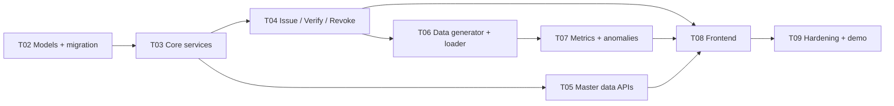

# CredSure: Implementation Roadmap

Total time box: **7 hours**. Elapsed so far: Task 01 (environment) and Task 00 (this
specification), about 1 hour. Remaining budget: **about 6 hours**. The plan prioritises a
working end-to-end demonstration: the backend core first, then data and anomalies, then UI.

## 1. Timeline

| # | Task | Budget | Depends on | Deliverables | Done when |
|---|------|-------:|------------|--------------|-----------|
| ✅ T01 | Environment setup | – | – | Three-tier skeleton, health check, tests | Completed |
| ✅ T00 | Business analysis and specification | – | T01 | `docs/*.md` (this set) | Completed |
| **T02** | **Domain models and first migration** (decisions D1–D4) | 1:05 | T00 | `core/timeutil.py` (D2), `database/types.py` (`UTCDateTime`), `database/session.py` transaction recipe (D3), `database/triggers.py`, `models/*` (9 entities), enums, Alembic revision `0001` with the final constraint set and the 16 triggers + 2 indexes (D1, D4), real-engine migration tests | `alembic upgrade head` works on a fresh DB. Tests prove FK/CHECK/UNIQUE/trigger behaviour, the trigger inventory, `recursive_triggers` and `BEGIN IMMEDIATE` serialisation. Health check reports `initialized`. |
| T03 | Core services: crypto, IDs, audit, eligibility | 0:50 | T02 | `services/crypto.py` (`canonical_json` rejects floats, score strings; D6), `ids.py`, `audit.py` (hash chain per ADR-020), `eligibility.py` (rule selection per D5), `core/security.py` (Actor, roles), `DomainError` handler + `IntegrityError` map | Unit tests for canonicalisation, hash, sign/verify, chain verification and each BR-04 reason |
| T04 | Issuance, verification, revocation + APIs | 0:50 | T03 | `issuance.py` (check order and `attempt_ref`, D7), `verification.py`, `revocation.py` (atomic, D1); routes for credentials, verifications, revocations, eligibility, audit; rule activation with the D5 date guard | API tests for every mandatory rule (traceability table in business_rules §10) |
| T05 | Master-data APIs | 0:30 | T03 | Routes and services for issuers (with key generation), learners, courses, rules (draft/activate), completions | CRUD tests; rule versioning tests |
| T06 | Synthetic data generator and loader | 0:50 | T03, T04 | `app/datagen` CLI: profiles, valid-first generation, A1–A4 injection plus hard negatives, ground truth, manifest, loader with attempt replay (attempt_ref + injected clock, D7); synthetic issuers `ISS-9nn` and keys under `backend/keys/synthetic/<profile>/` only (D8) | Starter and full generate deterministically (checksum test); platform key directory unchanged after generation; load succeeds within budget |
| T07 | Metrics, anomaly detectors, evaluation | 0:35 | T06 | `services/metrics.py`, `services/anomalies/*`, routes | Starter evaluation recall 1.0 / precision ≥ 0.95 (automated test); full run within budget |
| T08 | Frontend demo UI | 1:00 | T04, T07 | API client, role switcher, Dashboard, Issue, Credential Detail, Verify, Anomalies | Demo scenario (user_stories.md) works in the browser; lint, build and Vitest pass |
| T09 | Hardening, demo script, docs | 0:20 | all | README update, `docs/demo_script.md`, final full test run, known issues | All checks green; demo rehearsed once |
| | **Buffer** | 0:00 | | | |

Running total: 1:05 + 0:50 + 0:50 + 0:30 + 0:50 + 0:35 + 1:00 + 0:20 = **6:00**. The extra 15
minutes for T02 (decisions D1–D4) came from the buffer and T09. **No buffer remains**, so the
scope-cut order in §3 applies as soon as any task overruns.

## 2. Critical path

## 3. Scope-cut order (if behind schedule)

Cut from the top first. Items below the line must not be cut.

1. Audit Log page and Verification History page in the UI (data stays available through the API).
2. Audit `verify-chain` endpoint (keep the triggers and the stored hash chain).
3. Completion correction endpoint (FR-07).
4. Instructor course scoping (AS-10) and learner self-service views.
5. Credential expiry (keep the `expires_at` column, but generate no expiring rules).
6. Master-data create forms in the UI (use API or seed data).
7. Full-scale profile in the live demo (keep starter live; show full-scale results from a pre-run).

---
**Never cut:** eligibility-gated issuance · unique IDs · SHA-256 and Ed25519 · tamper and revocation detection in verification · append-only audit · rule versioning · seeded generation with separate ground truth · detectors A1–A4 with evaluation · end-to-end UI flow (issue → verify → revoke).

## 4. Definition of done (every task)

- Code follows the module layout in [architecture.md §3](architecture.md#3-backend-module-layout).
- New behaviour has pytest or Vitest coverage. `python -m pytest`, `npm run lint`, `npm run build` and `npm run test` all pass.
- No new dependencies unless explicitly approved and recorded in an ADR.
- No secrets, keys, databases or generated data committed.
- Docs updated where a decision changes.

## 5. Recommended first implementation task: T02

**T02: Domain models and initial Alembic migration.** Every other task depends on the schema.
The constraints and triggers enforce most mandatory rules (unique IDs, one active
rule/credential, append-only audit, immutable payloads) before any service code exists.

The decisions D1–D4 are recorded ([ADR-017 – ADR-020](architecture_decisions.md#pre-t02-decisions-d1d8)).
The order follows [schema_review §12](schema_review.md#12-recommended-implementation-order-for-t02).

Scope:
1. `app/database/session.py` (D3): add `recursive_triggers=ON`; set `isolation_level=None` in the `connect` event; add a `begin` event that emits `BEGIN IMMEDIATE` when `sqlite_write=True`; add `WriteSessionLocal`.
2. `app/core/timeutil.py` and `app/database/types.py` (D2): `utc_now`, `to_utc`, `format_utc`, `parse_utc`; `UTCDateTime` storing `YYYY-MM-DD HH:MM:SS`.
3. `app/models/enums.py` plus nine model modules matching [data_dictionary.md §3](data_dictionary.md#3-tables), registered in `app/models/__init__.py`.
   - Every `CheckConstraint` is explicitly named.
   - Composite UNIQUEs and FKs (D1).
   - Partial unique indexes with `sqlite_where`.
   - `sqlite_autoincrement=True` and `UNIQUE(previous_hash)` on `audit_events` (D4).
   - `audit_events.attempt_ref` (D7).
4. `app/database/triggers.py`: the 16 triggers and 2 indexes from [data_dictionary §6](data_dictionary.md#6-reference-ddl-triggers-and-expression-indexes), as `CREATE_STATEMENTS` / `DROP_STATEMENTS`.
5. Run `alembic revision --autogenerate --rev-id 0001 -m "initial schema"`, then hand-edit the result:
   - Replace the rendered `UTCDateTime()` with `sa.DateTime()`.
   - Confirm the CHECKs, composite FKs and partial indexes were rendered.
   - Apply `CREATE_STATEMENTS` with `op.execute` at the end of `upgrade()`.
   - Apply `DROP_STATEMENTS` first in `downgrade()`.
6. Integration tests on the **real engine** (D3): a temporary database file, `alembic upgrade head` in a fixture, and the application's session factories. Cases:
   - the trigger inventory
   - `recursive_triggers=1`
   - a second write session blocks
   - REPLACE fails on `credentials` and `audit_events`
   - composite FK mismatch rejected
   - credential format CHECK
   - second active credential and second active rule rejected
   - re-issue after revocation accepted
   - atomic revocation; reinstatement rejected; status change without a revocation rejected
   - credential evidence update rejected
   - rule criteria frozen; D5 date guard on UPDATE and INSERT
   - verification result inconsistent with its flags rejected
   - audit UPDATE/DELETE rejected; second genesis and fork rejected; chain-link mismatch rejected
   - duplicate attempt outcome rejected
   - synthetic-range CHECK
   - `downgrade base` followed by `upgrade head`
7. Confirm `/api/health` reports `initialized` on a migrated database.

## 6. After the hackathon (not planned)

- Real authentication (OIDC) and a user and role entity.
- W3C Verifiable Credentials / Open Badges 3.0 export and a public revocation status list.
- Key rotation workflow, encrypted key storage or KMS.
- QR/PDF credential rendering and learner wallet sharing links.
- PostgreSQL migration path (the SQLAlchemy and Alembic abstractions are already in place).
